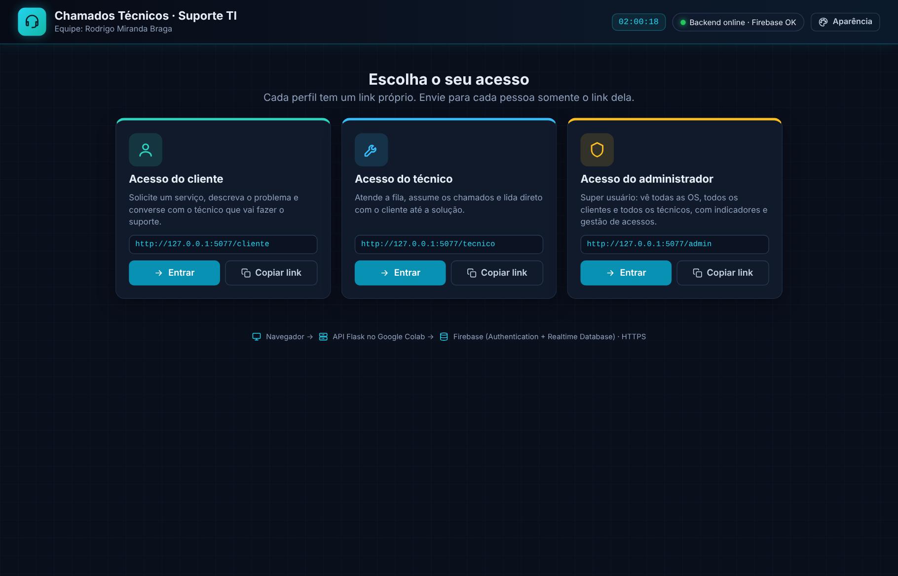
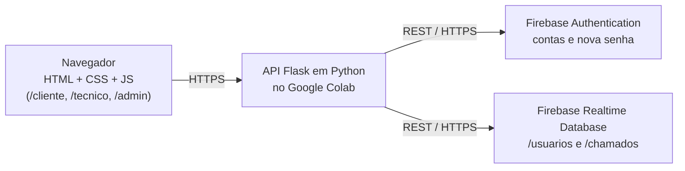
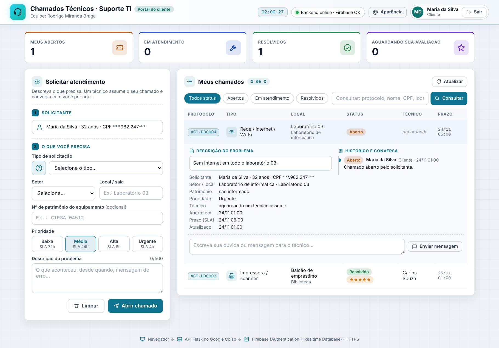
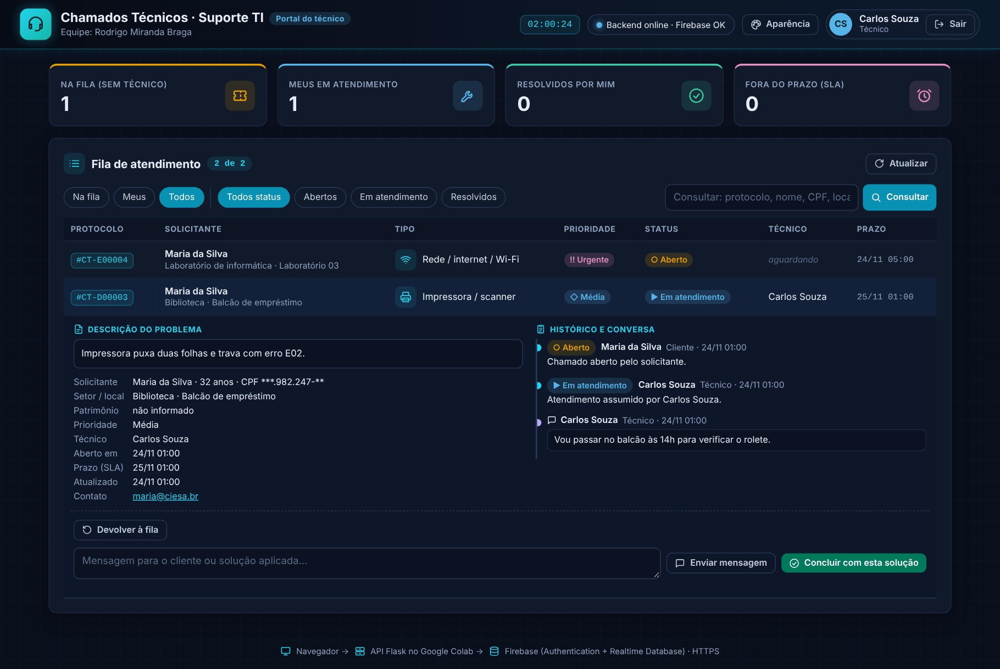
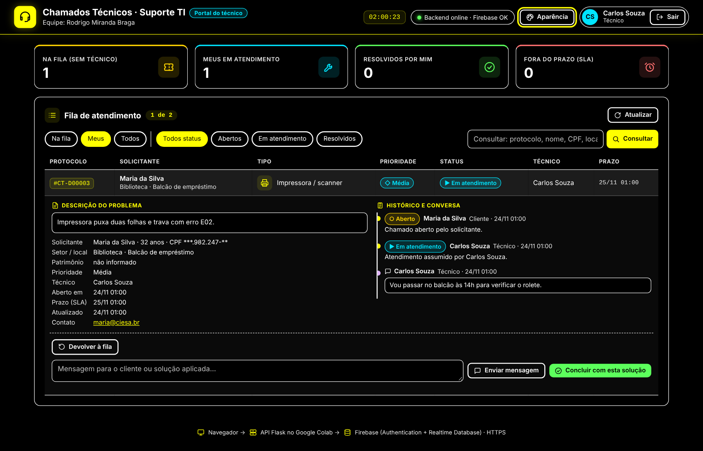
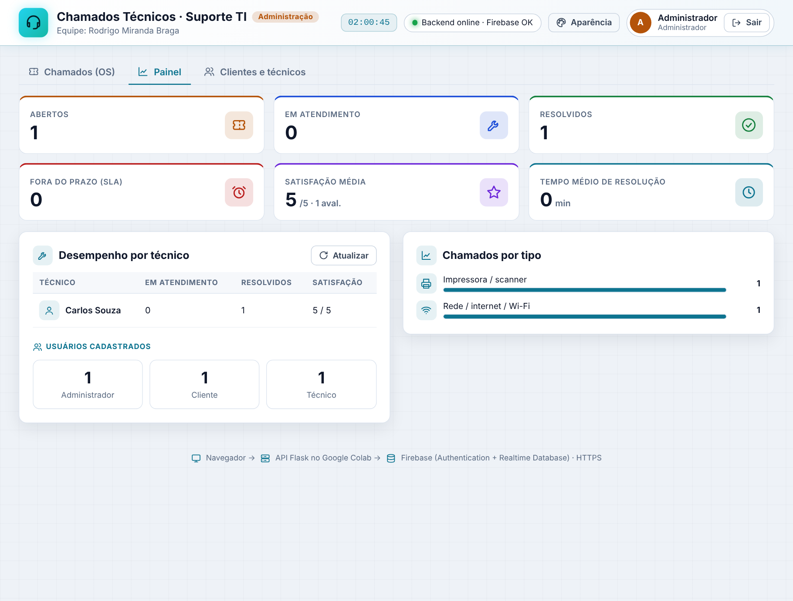
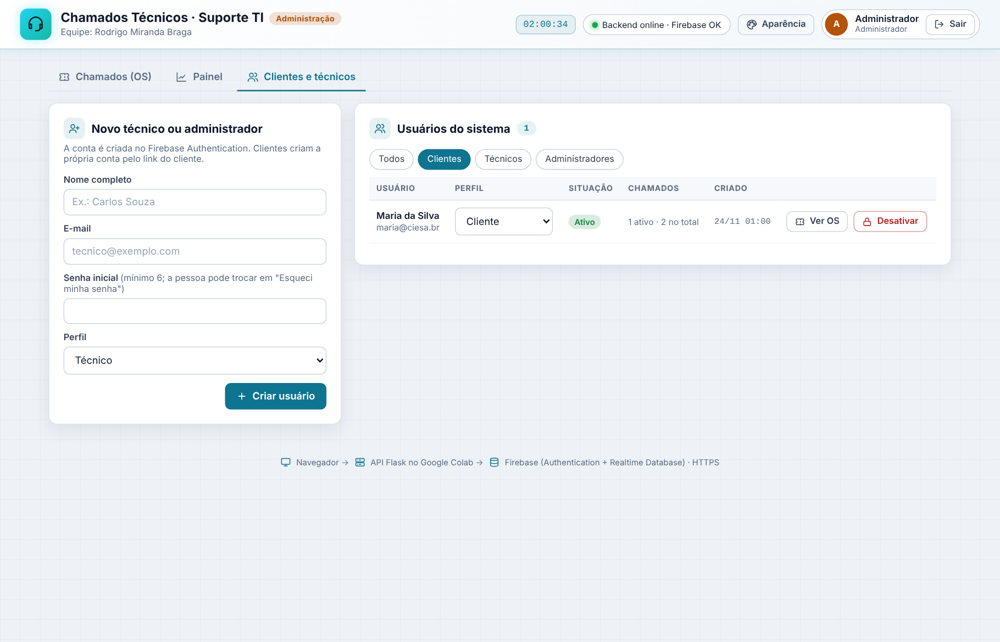

# Central de Chamados TI

Sistema web de chamados técnicos (ordens de serviço) para o suporte de TI de uma instituição de ensino, feito para o **Mini Hackathon NPC2** do curso de Análise e Desenvolvimento de Sistemas (CIESA). Roda inteiro no **Google Colab**: o backend em Python (Flask) aplica as regras de negócio e grava tudo no **Firebase** pela API REST, via HTTPS.

[](https://colab.research.google.com/github/dhyggao/central-chamados-ti/blob/main/notebook/Central_Chamados_TI.ipynb)



## Funcionalidades

**Três links de acesso**, cada um aceita apenas contas do seu perfil (a trava é feita no backend):

| Portal | Quem usa | O que faz |
|---|---|---|
| `/cliente` | quem precisa de suporte | cria a conta, solicita o serviço, conversa com o técnico, avalia (1 a 5 estrelas) ou reabre |
| `/tecnico` | equipe de suporte | atende a fila, assume chamados, fala direto com o cliente e conclui informando a solução |
| `/admin` | super usuário | vê todas as OS, todos os clientes e técnicos, painel de indicadores, atribuição e gestão de acessos |

**Mais recursos**

- Esqueci minha senha: o Firebase Authentication envia o link de redefinição por e-mail, em português.
- Aparência e acessibilidade: tema escuro, claro e alto contraste; paleta para daltonismo (Okabe-Ito) com símbolos nos status e prioridades; texto grande.
- Indicadores: fila, atendimentos, prazo (SLA) estourado, satisfação média, tempo médio de resolução e desempenho por técnico.
- Monitor ao vivo no Colab com cada requisição recebida e quem a fez.

## Arquitetura



O navegador nunca fala direto com o Firebase: toda leitura e escrita passa pelo backend, que valida os dados e decide o que cada usuário pode fazer. Um túnel gratuito da Cloudflare publica o backend do Colab num endereço HTTPS para outros computadores acessarem.

## Regras de negócio (em Python)

1. Validação de todos os campos: CPF com dígitos verificadores, idade, e-mail, senha com 6 ou mais caracteres.
2. Permissões por perfil e por portal: cada chamado chega ao navegador com a lista de ações que aquele usuário pode fazer.
3. Prazo de atendimento (SLA) pela prioridade: Urgente 4 h, Alta 8 h, Média 24 h, Baixa 72 h.
4. Atendimento preferencial: cliente com 60 anos ou mais sobe um nível de prioridade.
5. Um único chamado ativo por patrimônio; até 5 chamados ativos por cliente; CPF único por conta.
6. Só conclui com a solução descrita; avaliação uma única vez; a reabertura exige motivo e devolve o chamado à fila.

## Como rodar no Google Colab

1. **Firebase:** crie um projeto, ative o **Realtime Database** e, em *Authentication > Sign-in method*, ative **E-mail/senha**. Crie uma conta em *Authentication > Users*: ela será usada pelo backend e vira o administrador principal.
2. **Abra o notebook** pelo botão *Abrir no Colab* acima (ou faça upload de `notebook/Central_Chamados_TI.ipynb`).
3. **Cadastre os Secrets:** na barra lateral do Colab, clique no ícone de chave (*Secrets*), adicione os itens abaixo e ative *Acesso ao notebook* em cada um.

   | Nome | Valor |
   |---|---|
   | `FIREBASE_API_KEY` | apiKey do app Web (*Configurações do projeto > Geral*) |
   | `FIREBASE_DATABASE_URL` | ex.: `https://seu-projeto-default-rtdb.firebaseio.com` |
   | `FIREBASE_EMAIL` | e-mail da conta criada no passo 1 |
   | `FIREBASE_SENHA` | senha dessa conta |

4. **Rode a célula 1.** Aparecem os três links; mande cada um só para quem vai usar. Entre no `/admin` com a conta do passo 1 e cadastre os técnicos.
5. As outras células: **2** abre o sistema dentro do Colab, **3** mostra tabelas de chamados e usuários, **4** é o monitor ao vivo, **5** mostra o banco como está no Firebase.

CPFs válidos para teste: `529.982.247-25`, `123.456.789-09`, `111.444.777-35`.

## Segurança

- **Nenhuma credencial fica no código:** elas vêm dos Secrets do Colab (ou de variáveis de ambiente).
- **Regras do banco:** use `firebase/database.rules.json` para que só a conta do backend leia e grave. Troque `COLE_AQUI_O_UID_DA_CONTA_DO_BACKEND` pelo UID dessa conta (*Authentication > Users*, coluna *UID do usuário*) e cole em *Realtime Database > Regras*. Sem isso, qualquer pessoa com uma conta no seu Authentication conseguiria ler o banco direto.
- Senhas ficam só no Firebase Authentication (nunca no banco nem no log); o CPF aparece mascarado nas telas.
- As sessões ficam na memória do backend: se o Colab reiniciar, todos entram de novo.

## Estrutura do repositório

```
├── notebook/Central_Chamados_TI.ipynb   notebook pronto para o Colab (gerado pelo build.py)
├── src/
│   ├── backend_template.py              API Flask, regras de negócio e integração com o Firebase
│   ├── index.html                       frontend (os três portais e a página inicial)
│   └── celulas/                         células 2 a 5 do notebook
├── build.py                             junta src/ e gera o notebook
├── tests/
│   ├── harness.py                       Firebase simulado em memória (sem credenciais reais)
│   ├── test_api.py                      permissões, portais, regras de negócio e nova senha
│   └── test_ui.py                       teste ponta a ponta no navegador (Playwright)
├── firebase/database.rules.json         regras recomendadas para o Realtime Database
└── docs/img/                            capturas de tela
```

## Desenvolvimento

Edite os arquivos em `src/` e gere o notebook de novo:

```bash
python build.py
```

Testes (não usam o Firebase real):

```bash
pip install -r requirements-dev.txt
playwright install chromium
python tests/test_api.py
python tests/test_ui.py      # capturas de tela em tests/saida/
```

## Telas

| Cliente (tema claro) | Técnico (paleta para daltonismo) |
|---|---|
|  |  |

| Técnico (alto contraste) | Administrador (painel, texto grande) |
|---|---|
|  |  |



## Autor

Rodrigo Miranda Braga (DhyggaO) · Análise e Desenvolvimento de Sistemas, CIESA · Manaus, AM
